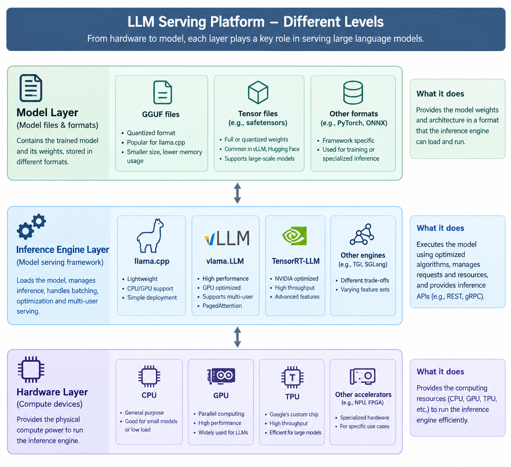

# Introduction of LLMs

## What is LLMs?

## How to train a LLM?

## How to serve a LLM?

In general, we have three layers in a LLM serving platform.
- hardware/os Layer
- inference engine Layer
- model Layer

The hardware layer is the most important, it will influence the choice of inference engine, then the model which you can
use.

In our case, we only focus on GPU and CPU.

### GPU

For more details of how to choose GPU, you can check the [hardware](./hardwares/README.md) section.

Based on your GPU, you can choose the model parameter size. `The best practice is the model should fit completely in
the VRAM of GPU`. Because most of the inference engine(e.g. vLLM / TensorRT-LLM / SGLang) will crash immediately if the
CUDA OOM.

> llama.cpp will gracefully offload overflowed model parameters into `system memory`. But the token generation speed will
> be slow.

### CPU

Ideally, we use GPU to serve LLMs, it provides better accuracy and throughput.

But when you don't have GPU, you can still run models on a CPU. The `CPUs lack massive parallel memory bandwidth of GPUs`,
So the more parameters the model have, the token generation speed is slower.

We have an approximative matrix on Model parameter size and token generation speed.

Here we suppose you have llama.cpp and quantized model such as Q4-K-M in GGUF format. You have the latest CPU and 128GB DDR5 system memory

| Model Parameter Size | Approx. RAM Needed (4-bit GGUF) | CPU Performance Expectation                                                    |
|----------------------|---------------------------------|--------------------------------------------------------------------------------|
| 1B – 4B              | 2 – 4 GB                        | Blazing fast (~40–60 tokens/sec)                                               |
| 7B – 12B             | 6 – 10 GB                       | Very Usable (~10–25 tokens/sec)                                                |
| 20B – 30B            | 14 – 20 GB                      | Acceptable (~3–8 tokens/sec)                                                   |
| 70B+                 | 40 GB+                          | Too slow (Unless you have a high-end multi-channel workstation CPU/RAM layout) |

> PS when the model generates token, the CPU will be 100% used. Nothing else can run on the server.

## Building GenAI with LLMs

HuggingFace: 
LangChain: framework for building agents and LLM-powered applications. 
DSPy: framework for building modular AI systems and offers algorithms for optimizing their prompts and weights.

## HuggingFace
https://github.com/huggingface

## LangChain

## DsPy:

https://github.com/stanfordnlp/dspy

## watch 

SGLang, TensorRT-LLM

Optimize aggressively: tensor parallelism, quantization (FP8, AWQ, GPTQ), KV-cache and prefix caching, continuous batching, speculative decoding, concurrency tuning.

Serve multiple models and features off shared hardware: multi-LoRA, routing, and request scheduling that balances internal workloads against latency-sensitive product traffic. 

## Train base model into a reasoning model

This is a free Google Colab notebook for turning Phi-4 into a reasoning model: https://colab.research.google.com/github/unslothai/notebooks/blob/main/nb/Phi_4_(14B)-GRPO.ipynb
